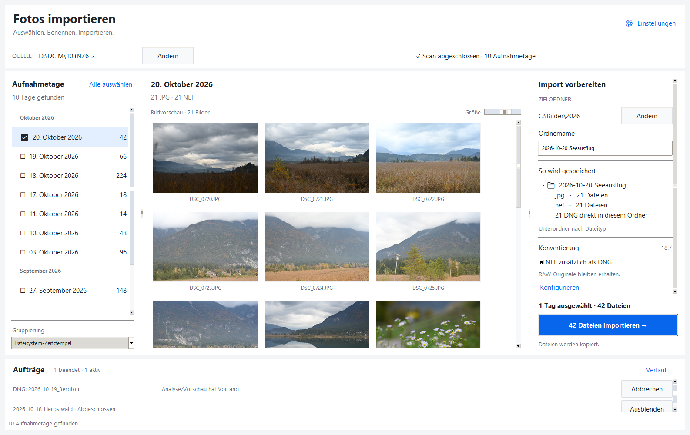

# Foto-Importer

Tkinter-Anwendung zum Gruppieren von Kamera-Dateien nach Datum, mit
Bildvorschau und Kopieren in Unterordner je Dateiendung. Als Datumsquelle
stehen Dateisystem-Zeitstempel und Foto-Metadaten zur Verfügung.

Die Sammlung unterstützt außerdem lokale Gesichtserkennung, Personen, Vorschläge,
Referenzdatensätze und Familienbeziehungen unter **Gesichter & Personen**.
[Installation und Bedienung](docs/gesichtserkennung-umsetzung.md) ·
[Modellgewichte und Lizenzen](models/README.md).



## Import-Arbeitsfläche

Oben die Quelle auswählen. Links lassen sich einzelne Aufnahmetage ohne
Strg-Taste ankreuzen oder gemeinsam auswählen. Die Mitte zeigt alle verfügbaren
Bildvorschauen des zuletzt fokussierten Tages; die angekreuzten Tage bestimmen,
welche Dateien importiert werden. Die Vorschaugröße ist über den Schieberegler
änderbar. Eine Begrenzung der Bildanzahl gibt es nicht mehr.

Die Galerie reserviert sofort die Scrollfläche für den gesamten Tag. Sichtbare
Bilder beginnen als weiße Platzhalter und werden im Hintergrund nachgeladen.
Zuerst kommen die sichtbaren Bilder, danach je zwei benachbarte Reihen als
Vorlauf. Beim Scrollen ersetzt der aktuelle Ausschnitt überholte Ladeaufträge.
Auch bei Tausenden Bildern existieren nur für den sichtbaren Bereich
Canvas-Elemente und Tk-Bilder. Nicht mehr benötigte Anzeigebilder werden
freigegeben; der begrenzte Thumbnail-Cache erleichtert das Zurückscrollen.

Rechts Zielordner und Ordnername festlegen. Die Ablagevorschau zeigt die
Unterordner je Dateityp und gegebenenfalls die DNGs direkt im Importordner.
**Dateien importieren** kopiert alle Dateien der angekreuzten Tage in diesen
gemeinsamen Ordner. Namen mit Pfadbestandteilen oder unter Windows reservierten
Zeichen werden abgewiesen. Quelle und Ziel der letzten Sitzung werden beim
Start wiederhergestellt; der Quellscan startet im Hintergrund.

Die drei Spalten sind über ihre Trennlinien verstellbar. Die Galerie passt ihre
Spaltenzahl an den verfügbaren Platz an. Auf kleineren Fenstern scrollen die
Importoptionen, während die Importaktion sichtbar bleibt. Einstellungen und
Auftragsverlauf öffnen eigene Fenster ohne die Hauptoberfläche zu sperren.

Die Auftragsleiste unten zeigt aktive Vorgänge und die letzten zwei Ergebnisse.
Weitere Aufträge sind scrollbar; **Verlauf** enthält die letzten 100 Ergebnisse
der laufenden Sitzung. Abgeschlossene Imports können über **Ordner öffnen**
im Explorer angezeigt werden.

Scan, Dateizählung, Vorschaudekodierung, Ziel-/Converter-Prüfung, Kopieren und
DNG-Konvertierung laufen in Hintergrundthreads; Adobe läuft in eigenen
Prozessen. Veraltete Vorschau- und Auswahlergebnisse werden verworfen. Tk-Widgets
werden ausschließlich im UI-Thread aktualisiert. Die Zustellung von Ergebnissen
gibt nach rund 8 ms an die Ereignisschleife zurück; lange Datumslisten werden
in Portionen von 100 Zeilen aufgebaut.

Die bisherigen Benutzereinstellungen bleiben gültig. Neue Installationen
starten mit einer Fenstergröße von 1500 × 980 Pixeln. Der frühere Wert
`preview_count` wird ignoriert; die zugehörige Einstellung entfällt.
Die Konstanten für Worker-Abfragen und Cachegrößen bleiben unverändert.

Eine Vorschau mit isolierten Einstellungen und ohne Kopieren oder Konvertieren:

```powershell
uv run python scripts/preview_workspace.py --source D:/DCIM/103NZ6_2
```

Mit `--output docs/screenshots/import-workspace.png` wird unter Windows ein
Screenshot dieses Fensters erstellt und die Vorschau geschlossen. Die
Auftragszeilen und Versionsangaben in dieser Vorschau sind Beispieldaten.

```powershell
uv sync
uv run python main.py
```

## Vorrang für Analyse und Vorschau

Ordner-Scan, Dateizählung, Bildvorschau und die Zielprüfung neuer Imports haben
automatisch Vorrang vor Kopieren und DNG-Konvertierung. Weitere Aufnahmetage
lassen sich deshalb auch bei laufenden Aufträgen analysieren und als neue
Imports einreihen. Es muss dafür keine Priorität pro Auftrag eingestellt werden.

Während dieser interaktiven Arbeit warten neue Kopier-/Konvertieraufträge.
Laufende Kopien geben zwischen Datenblöcken von 1 MiB nach, auch mitten in
einer großen Datei. Danach werden sie automatisch fortgesetzt. Ein bereits
laufender Adobe-Prozess beendet seine aktuelle Datei mit niedriger CPU-Priorität;
die nächste Datei startet erst nach Ende der Analyse. Bereits an das Laufwerk
übergebene Zugriffe lassen sich dabei nicht unterbrechen.

Standardmäßig führen höchstens **ein Kopierauftrag und eine DNG-Konvertierung**
gleichzeitig aus. Weitere Aufträge warten je Kategorie in Eingangsreihenfolge
und lassen sich auch im Wartezustand abbrechen. Die Auftragsleiste zeigt
**Analyse/Vorschau hat Vorrang** oder **Wartet auf freien Ausführungsplatz**.
Beim Abbruch einer Kopie wird ihre unvollständige Zieldatei entfernt; fertige
Kopien und Quelldateien bleiben erhalten.

Unter Windows laufen die Python-Kopier-/Konvertierthreads im
[Windows-Hintergrundmodus](https://learn.microsoft.com/en-us/windows/win32/api/processthreadsapi/nf-processthreadsapi-setthreadpriority).
Adobe startet mit `IDLE_PRIORITY_CLASS`. Die Priorität des GUI-Prozesses und
seiner Analyse-/Vorschau-Threads wird nicht abgesenkt. Auf anderen Plattformen
bleiben die Warteschlange und die kooperativen Pausen wirksam.

Zentrale Vorgaben in `config/settings.py`:

| Vorgabe | Standard |
| --- | --- |
| `BACKGROUND_COPY_JOBS` | 1 gleichzeitig ausführender Kopierauftrag |
| `BACKGROUND_DNG_JOBS` | 1 gleichzeitig ausführender DNG-Auftrag |
| `BACKGROUND_COPY_CHUNK_BYTES` | 1.048.576 Bytes |
| `FOREGROUND_SETTLE_SECONDS` | 0,15 Sekunden Ruhe vor Wiederaufnahme |

Die kurze Ruhezeit verhindert ständiges Anlaufen der Hintergrundaufträge
zwischen Dateizählung und Bildvorschau oder beim schnellen Wechsel der Auswahl.

## NEF nach DNG konvertieren

Rechts unter **Konvertierung** die Option **NEF zusätzlich als DNG** aktivieren.
Der Standardpfad ist
`C:\Program Files\Adobe\Adobe DNG Converter\Adobe DNG Converter.exe`;
über **Einstellungen** lässt sich eine andere Installation auswählen. Die Option
ist zunächst deaktiviert. Option und Programmpfad werden gespeichert
(`convert_to_dng`, `dng_converter_path` in den Benutzereinstellungen).

Nach erfolgreichem Kopieren verarbeitet die Anwendung alle `.nef`-Dateien
aus `<Zielordner>/<Name>/nef` und legt die DNGs direkt in
`<Zielordner>/<Name>` ab, entsprechend dem bisherigen Batch-Skript.
Groß-/Kleinschreibung der NEF-Endung spielt keine Rolle. Bereits vorhandene
DNG-Dateinamen werden übersprungen; RAW-Dateien bleiben erhalten.

Jeder Ordner hat einen unabhängigen Hintergrundauftrag mit einem eigenen
Adobe-Prozess für die gerade bearbeitete Datei. Die gemeinsame Steuerung begrenzt
gleichzeitig ausführende Ordner und gibt Analyse und Vorschau Vorrang; Dateien
innerhalb eines Ordners werden nacheinander konvertiert. Unter Windows laufen
die Adobe-Prozesse mit niedrigerer Priorität. Scan, Vorschau und neue
Kopieraufträge bleiben bedienbar.
Das Programm startet Adobe ohne Shell mit getrennten Pfadargumenten, sodass
Leerzeichen und Sonderzeichen in Ordnernamen unterstützt werden.

**Aufträge** zeigt pro Ordner die abgearbeiteten Dateien einschließlich
übersprungener DNGs. Der Fortschritt steigt nach jeder fertigen Datei;
innerhalb einer einzelnen Datei gibt es keine Prozentanzeige. Abschluss,
Fehler oder Abbruch bleiben als Ergebnis im Verlauf. **Abbrechen** beendet nur
die Konvertierung dieses Ordners. Beim Schließen werden aktive
Konvertierungen ebenfalls abgebrochen. Fertige DNGs und kopierte Dateien
bleiben erhalten. Ein Konvertierungsfehler stellt die bereits erfolgreich
kopierten Datumsgruppen nicht erneut in die Quellliste ein.

Adobe schreibt zunächst in einen temporären Unterordner. Erst nach einem
erfolgreichen Prozessende und einer nicht leeren DNG-Ausgabe wird die Datei
ins Ziel übernommen. Ein Abbruch oder Fehler entfernt temporäre und
unvollständige Ausgaben dieses Auftrags. Die Anwendung prüft dabei nicht den
vollständigen DNG-Dateiinhalt. Ein Neustart desselben Imports ist erst nach
Abschluss des bisherigen Kopier-/DNG-Auftrags möglich.

## Performance

Die Optimierung verwendet beim rekursiven Scan `os.scandir`, um bereits vom
Betriebssystem gelieferte Dateiinformationen wiederzuverwenden. Unpassende
Dateiendungen werden früh aussortiert; ein Abbruch wird auch während der
Verzeichnissuche geprüft.

Worker übergeben Ergebnisse über eine Queue an Tkinter. Fortschrittsmeldungen
werden zusammengefasst und alle 50 ms vom UI-Thread abgeholt. Damit wartet der
Scan oder Kopiervorgang nicht mehr pro Datei auf Tkinter. Abschluss- und
Fehlermeldungen bleiben erhalten.

Vorschaubilder werden von einem einzelnen Hintergrund-Worker geladen. Es gibt
höchstens einen aktiven und einen austauschbaren wartenden Ladeauftrag.
Veraltete Vorschauaufträge werden abgebrochen; nur der UI-Thread erzeugt
Tkinter-Bilder für sichtbare Zellen. Ein LRU-Cache hält bis zu 128 kleine
Vorschaubilder und prüft
Dateigröße sowie Änderungs- und Erstellungs-/Metadatenzeit auf Änderungen.
JPEG-Decodierung nutzt die reduzierte Auflösung des Decoders; EXIF-Rotation
wird berücksichtigt. Die Grenzwerte `UI_POLL_INTERVAL_MS` und
`THUMBNAIL_CACHE_SIZE` stehen zentral in `config/settings.py`. Die neue Konstante
`PREVIEW_PREFETCH_ROWS = 2` bestimmt den Vorlauf je Seite des sichtbaren
Ausschnitts; alle anderen Benutzereinstellungen bleiben gültig.

Beim Kopieren gleichnamiger Dateien wird der nächste freie Nummernsuffix
weitergezählt. Vorhandene Zieldateien werden weiterhin geprüft und behalten.
Der Fortschritt zählt erst fertig kopierte Dateien.

### Lokaler Vergleich mit Sicherungscommit `b0d08d7`

Windows, identische synthetische Testdaten auf dem lokalen Laufwerk, Median
aus fünf Scan-Durchläufen bzw. drei Durchläufen für die übrigen Messungen:

| Messung | Vorher | Nachher | Faktor |
| --- | ---: | ---: | ---: |
| Scan von 6.000 Dateien ohne UI | 0,5092 s | 0,1898 s | 2,68× |
| Scan von 6.000 Dateien mit Tk-Fortschrittsübergabe | 1,4530 s | 0,1983 s | 7,33× |
| Acht JPEG-Vorschauen, je 24 MP, leerer Anwendungscache | 1,6575 s | 1,6770 s | 0,99× |
| 400 gleiche Dateinamen kopieren, leere Dateien | 3,1189 s | 0,5599 s | 5,57× |

Die acht bereits gecachten Vorschaubilder wurden in rund 0,0004 s geladen.
Die erstmalige Vorschauerzeugung ist in dieser Messung etwa gleich schnell,
blockiert aber die Oberfläche nicht mehr. Der UI-Scan-Benchmark verwendet
echte Tkinter-Aufrufe mit einem leeren Fortschritts-Callback, ohne Widgets
neu zu zeichnen. Die Kopiermessung untersucht Namenskollisionen, nicht den
Datendurchsatz großer Dateien. Speicherkarte, USB-Verbindung, Ziellaufwerk
und Betriebssystemcache beeinflussen die Ergebnisse im echten Einsatz.

Vergleich wiederholen (nutzt temporäre Testdaten und liest den alten Code
direkt aus Git):

```powershell
uv run python -m benchmarks.performance --baseline b0d08d7
```

## DNG-Versionsprüfung

Bei jedem Programmstart wird die installierte DNG-Converter-Version aus den
Windows-Dateiinformationen gelesen. Die Einstellungen zeigen die Version und
gegebenenfalls einen Updatehinweis mit einem Button zur Adobe-Downloadseite.
Der Button öffnet den Browser; eine Installation startet nicht automatisch.

Die aktuelle Adobe-Version wird im Hintergrund anhand der Weiterleitung des
offiziellen Windows-Downloadlinks ermittelt. Eine HEAD-Anfrage lädt keinen
Installer herunter. Pro lokalem Kalendertag erfolgt höchstens ein Versuch;
weitere Programmstarts verwenden das gespeicherte Ergebnis. Auch fehlgeschlagene
Versuche werden für den Tag gespeichert. Bei fehlendem Internet oder einem
geänderten Adobe-Link erscheint ein Hinweis, und die nächste Prüfung erfolgt
beim ersten Programmstart an einem folgenden Tag. Import und Konvertierung
bleiben während der Prüfung bedienbar.

`DNG_DOWNLOAD_URL` und `DNG_UPDATE_TIMEOUT_SECONDS` (5 Sekunden pro Netzwerkanfrage)
stehen in `config/settings.py`. Prüftag und Ergebnis werden unter
`dng_update_check` in der vorhandenen Benutzer-Einstellungsdatei gespeichert.

## Tests

```powershell
uv run python -m pytest
```

Die Tests prüfen Datumsermittlung, Scan-Abbruch, wiederverwendete
Dateiinformationen, Dateinamenskollisionen, Kopierfehler, Cache-Verhalten,
UI-Thread-Zustellung sowie den Ablauf Scan → Vorschau → Kopieren mit echten
Tkinter-Widgets. Für die GUI-Tests wird eine grafische Sitzung benötigt.
Die DNG-Tests verwenden echte, unabhängige Testprozesse anstelle von Adobe
und prüfen Parallelität, Abbruch, Fehlerausgaben, vorhandene DNGs sowie
Kopieren → Konvertieren mit echten Tkinter-Widgets. Eine Konvertierung
echter NEF-Aufnahmen mit Adobe muss zusätzlich manuell geprüft werden.

## Sammlungsindex

Unter **Sammlung · Index** lässt sich der Zielordner erfassen, mit Kamera-Metadaten
anreichern und auf Verschiebungen sowie Prüfsummenfehler prüfen. Bekannte Fotos
werden beim Import standardmäßig übersprungen. Metadaten und Import-Prüfung
benötigen ExifTool. Details: [Bedienung und Betriebshinweise](docs/collection-index.md).

Die neue [Metadatenansicht](docs/metadata-visualization.md) zeigt Kennzahlen,
Kamera- und ISO-Diagramme, eine filterbare Fotoliste und Bildvorschau mit EXIF-Daten.
Über **Sammlung · Metadaten** öffnen; Scan-Funktionen bleiben im Reiter **Index**.
