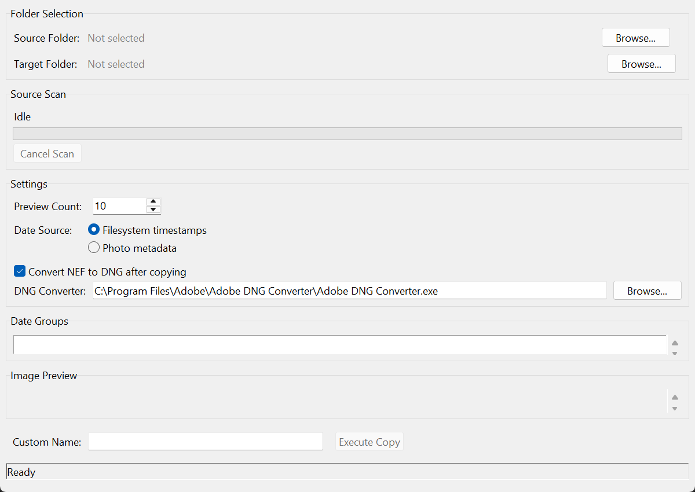

# Foto-Importer

Tkinter-Anwendung zum Gruppieren von Kamera-Dateien nach Datum, mit
Bildvorschau und Kopieren in Unterordner je Dateiendung. Als Datumsquelle
stehen Dateisystem-Zeitstempel und Foto-Metadaten zur Verfügung.

```powershell
uv sync
uv run python main.py
```

## NEF nach DNG konvertieren

Unter **Settings** die Option **Convert NEF to DNG after copying** aktivieren.
Der Standardpfad ist
`C:\Program Files\Adobe\Adobe DNG Converter\Adobe DNG Converter.exe`;
über **Browse...** lässt sich eine andere Installation auswählen. Die Option
ist zunächst deaktiviert. Option und Programmpfad werden gespeichert
(`convert_to_dng`, `dng_converter_path` in den Benutzereinstellungen).



Nach erfolgreichem Kopieren verarbeitet die Anwendung alle `.nef`-Dateien
aus `<Zielordner>/<Name>/nef` und legt die DNGs direkt in
`<Zielordner>/<Name>` ab, entsprechend dem bisherigen Batch-Skript.
Groß-/Kleinschreibung der NEF-Endung spielt keine Rolle. Bereits vorhandene
DNG-Dateinamen werden übersprungen; RAW-Dateien bleiben erhalten.

Jeder Ordner hat einen unabhängigen Hintergrundauftrag mit einem eigenen
Adobe-Prozess für die gerade bearbeitete Datei. Verschiedene Ordner laufen
parallel, Dateien innerhalb eines Ordners nacheinander. Unter Windows
laufen die Adobe-Prozesse mit niedrigerer Priorität. Scan, Vorschau und neue
Kopieraufträge bleiben bedienbar; CPU und Laufwerk werden weiterhin geteilt.
Das Programm startet Adobe ohne Shell mit getrennten Pfadargumenten, sodass
Leerzeichen und Sonderzeichen in Ordnernamen unterstützt werden.

**Copy and DNG Jobs** zeigt pro Ordner die abgearbeiteten Dateien einschließlich
übersprungener DNGs. Der Fortschritt steigt nach jeder fertigen Datei;
innerhalb einer einzelnen Datei gibt es keine Prozentanzeige. Abschluss,
Fehler oder Abbruch bleiben bis **Dismiss** sichtbar. **Cancel** beendet nur
die Konvertierung dieses Ordners. Beim Schließen werden aktive
Konvertierungen ebenfalls abgebrochen. Fertige DNGs und kopierte Dateien
bleiben erhalten. Ein Konvertierungsfehler stellt die bereits erfolgreich
kopierten Datumsgruppen nicht erneut in die Quellliste ein.

Adobe schreibt zunächst in einen temporären Unterordner. Erst nach einem
erfolgreichen Prozessende und einer nicht leeren DNG-Ausgabe wird die Datei
ins Ziel übernommen. Ein Abbruch oder Fehler entfernt temporäre und
unvollständige Ausgaben dieses Auftrags. Die Anwendung prüft dabei nicht den
vollständigen DNG-Dateiinhalt. Ein Neustart desselben Imports ist erst nach
Abschluss des bisherigen Kopier-/DNG-Auftrags möglich.

## Performance

Die Optimierung verwendet beim rekursiven Scan `os.scandir`, um bereits vom
Betriebssystem gelieferte Dateiinformationen wiederzuverwenden. Unpassende
Dateiendungen werden früh aussortiert; ein Abbruch wird auch während der
Verzeichnissuche geprüft.

Worker übergeben Ergebnisse über eine Queue an Tkinter. Fortschrittsmeldungen
werden zusammengefasst und alle 50 ms vom UI-Thread abgeholt. Damit wartet der
Scan oder Kopiervorgang nicht mehr pro Datei auf Tkinter. Abschluss- und
Fehlermeldungen bleiben erhalten.

Vorschaubilder werden von einem einzelnen Hintergrund-Worker geladen.
Veraltete Vorschauaufträge werden abgebrochen; nur der UI-Thread erzeugt
Tkinter-Bilder. Ein LRU-Cache hält bis zu 128 kleine Vorschaubilder und prüft
Dateigröße sowie Änderungs- und Erstellungs-/Metadatenzeit auf Änderungen.
JPEG-Decodierung nutzt die reduzierte Auflösung des Decoders; EXIF-Rotation
wird berücksichtigt. Die Grenzwerte `UI_POLL_INTERVAL_MS` und
`THUMBNAIL_CACHE_SIZE` stehen zentral in `config/settings.py`; bestehende
Benutzereinstellungen bleiben gültig.

Beim Kopieren gleichnamiger Dateien wird der nächste freie Nummernsuffix
weitergezählt. Vorhandene Zieldateien werden weiterhin geprüft und behalten.
Der Fortschritt zählt erst fertig kopierte Dateien.

### Lokaler Vergleich mit Sicherungscommit `b0d08d7`

Windows, identische synthetische Testdaten auf dem lokalen Laufwerk, Median
aus fünf Scan-Durchläufen bzw. drei Durchläufen für die übrigen Messungen:

| Messung | Vorher | Nachher | Faktor |
| --- | ---: | ---: | ---: |
| Scan von 6.000 Dateien ohne UI | 0,5092 s | 0,1898 s | 2,68× |
| Scan von 6.000 Dateien mit Tk-Fortschrittsübergabe | 1,4530 s | 0,1983 s | 7,33× |
| Acht JPEG-Vorschauen, je 24 MP, leerer Anwendungscache | 1,6575 s | 1,6770 s | 0,99× |
| 400 gleiche Dateinamen kopieren, leere Dateien | 3,1189 s | 0,5599 s | 5,57× |

Die acht bereits gecachten Vorschaubilder wurden in rund 0,0004 s geladen.
Die erstmalige Vorschauerzeugung ist in dieser Messung etwa gleich schnell,
blockiert aber die Oberfläche nicht mehr. Der UI-Scan-Benchmark verwendet
echte Tkinter-Aufrufe mit einem leeren Fortschritts-Callback, ohne Widgets
neu zu zeichnen. Die Kopiermessung untersucht Namenskollisionen, nicht den
Datendurchsatz großer Dateien. Speicherkarte, USB-Verbindung, Ziellaufwerk
und Betriebssystemcache beeinflussen die Ergebnisse im echten Einsatz.

Vergleich wiederholen (nutzt temporäre Testdaten und liest den alten Code
direkt aus Git):

```powershell
uv run python -m benchmarks.performance --baseline b0d08d7
```

## Tests

```powershell
uv run python -m pytest
```

Die Tests prüfen Datumsermittlung, Scan-Abbruch, wiederverwendete
Dateiinformationen, Dateinamenskollisionen, Kopierfehler, Cache-Verhalten,
UI-Thread-Zustellung sowie den Ablauf Scan → Vorschau → Kopieren mit echten
Tkinter-Widgets. Für die GUI-Tests wird eine grafische Sitzung benötigt.
Die DNG-Tests verwenden echte, unabhängige Testprozesse anstelle von Adobe
und prüfen Parallelität, Abbruch, Fehlerausgaben, vorhandene DNGs sowie
Kopieren → Konvertieren mit echten Tkinter-Widgets. Eine Konvertierung
echter NEF-Aufnahmen mit Adobe muss zusätzlich manuell geprüft werden.
