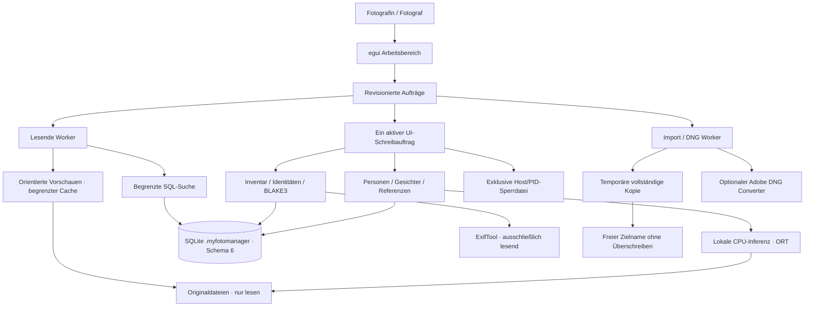
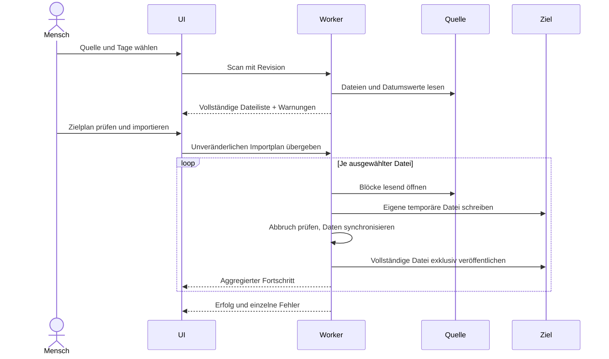

# Architektur

Die Python-Referenz ist Commit `32fbe4761b47f637a79505d783c94a2969ebc599`.
Rust enthält Domainservices und eine native egui-Oberfläche. Python ist für
den Betrieb nicht erforderlich. Entwicklung und Prüfung erfolgen unter Windows.

## Grenzen und Zuständigkeiten

* `src/config.rs`: Arbeitsplatzkonfiguration und zentrale Ressourcenlimits.
* `src/core/files.rs`: Quellscan, Namensprüfung, Kopien und Adobe-Prozesse.
* `src/core/jobs.rs`: Worker-Lebenszyklus, Abbruch und Fortschritt.
* `src/core/collection.rs`: DB-Sperre, Inventar und Integritätsprüfung.
* `src/core/metadata.rs`: ExifTool und parametrisierte Suchabfragen.
* `src/core/faces.rs`: Personenentscheidungen, Gruppen, Beziehungen und Referenzen.
* `src/core/inference.rs`: geprüfte Modellmanifeste und lokale ONNX-Ausführung.
* `src/core/previews.rs`: Vorschauen ohne dauerhaften Vollbildspeicher.
* `src/ui/`: Darstellung und UI-Zustand; keine SQL- oder Kopierlogik.

Schema, Trigger und Projektionsregeln stammen aus der Referenz. Die vorhandenen
ADRs sind Constraints, keine Behauptung vollständiger Funktionsparität.
Der überprüfte Implementierungsstand steht in [paritaet.md](paritaet.md).
