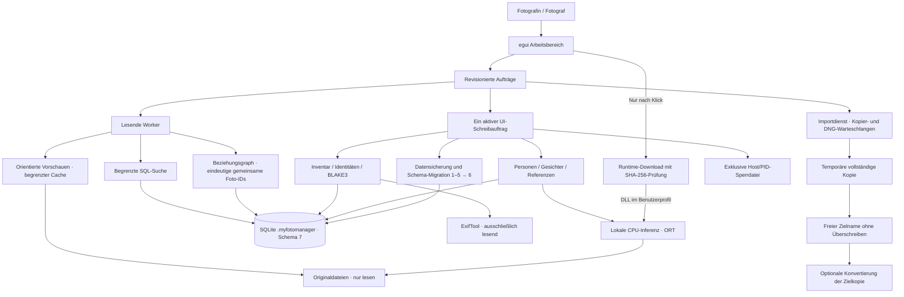
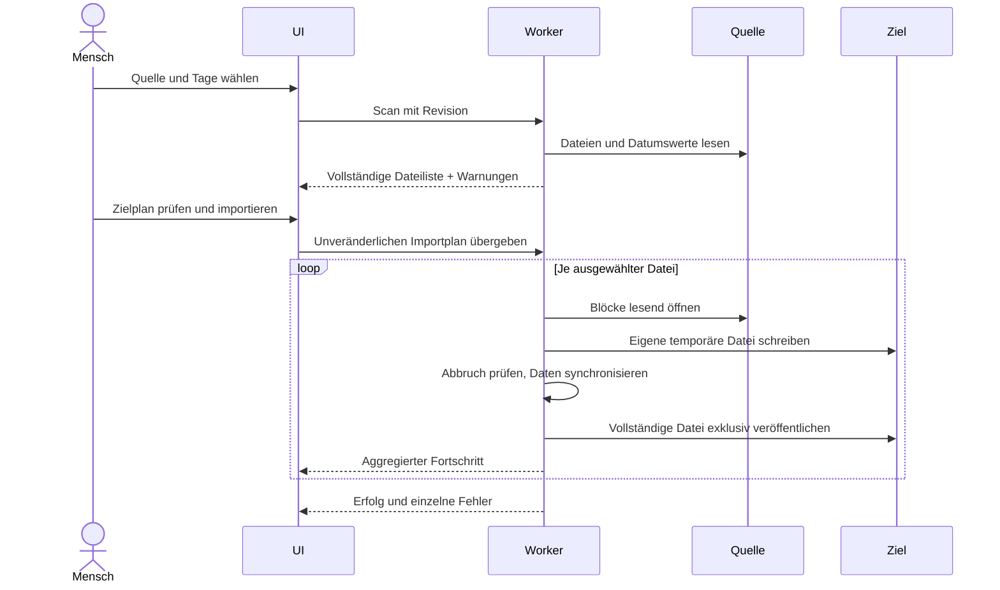

# Architektur

Die Python-Referenz ist Commit `32fbe4761b47f637a79505d783c94a2969ebc599`, nur noch lokal
in `C:\ttt\foto-importer`.
Rust enthält Domainservices und eine native egui-Oberfläche. Python ist für
den Betrieb nicht erforderlich. Entwicklung und Prüfung erfolgen unter Windows.

Beim Öffnen einer bestehenden Sammlung bleibt die Suche lesend. Erst ein
Schreibauftrag übernimmt die exklusive Sammlungssperre und migriert ältere
Schemas nach einer Sicherung. Hintergrundaufgaben geben interaktiven Aufträgen
Vorrang; neue Suchabfragen können veraltete SQL-Arbeit abbrechen. Nach dem Kopieren
nutzt eine optionale DNG-Konvertierung ihre eigene Warteschlange.

## Grenzen und Zuständigkeiten

* `src/config.rs`: Arbeitsplatzkonfiguration und zentrale Ressourcenlimits.
* Import: `files.rs` (Quellscan, Namensprüfung, Kopien, Adobe-Prozesse),
  `import_service.rs` (Vorprüfung, Importablauf, Berichte), `dng_updates.rs`
  (Tagesprüfung der Adobe-Version).
* Aufträge und Diagnose: `jobs.rs` (Worker, Abbruch, Bahnen), `progress.rs` (Phasen,
  Restzeit), `diag.rs` (Diagnose-Log), `scope.rs` (Portionen, Ordnerumfang).
* Sammlung: `collection.rs` (Sperre, Inventar, Integrität), `known_files.rs` (Bestand im
  Speicher während eines Laufs), `migrations.rs` (Schemawechsel 1–5 → 6),
  `backup.rs` (Datensicherung als ZIP, einziger Sicherungsweg), `missing.rs` (fehlende
  Dateien), `metadata.rs` (ExifTool, Suche), `folders.rs` (Ordnerbaum), `start_view.rs`,
  `thumb_cache.rs`, `local_cache.rs` (lokale Caches), `previews.rs` (Vorschauen).
* Gesichter: `faces.rs` (Aufträge, Seiten, Zuordnungen), `grouping.rs` (Gruppen),
  `matching.rs` und `recognition.rs` (Referenzen, Vorschläge, Abgleich, MatchCache),
  `inference.rs` und `face_models.rs` (Modelle, ONNX), `onnx_runtime.rs` (Runtime-Download),
  `evaluation.rs` (Schwellenmessung), `maintenance.rs` (Export, Kalibrierung,
  Biometrielöschung, Zusammenführen).
* Personen: `relations.rs`, `kinship.rs`, `gaps.rs` (Beziehungen, Verwandtschaft,
  Rückfragen), `people_table.rs`, `person_insights.rs`, `duplicates.rs`,
  `relationship_graph.rs` und `graph_layout.rs` (Graph), `tree_layout.rs` (Stammbaum),
  `central.rs` mit `central/rels.rs` (zentraler Bestand), `choice_filter.rs` (Tippfilter).
* Zeitreise: `timeline.rs`, `timeline_export.rs`.
* `src/ui/`: Darstellung und UI-Zustand (`app/` je Ansicht, Vorschau-Warteschlange,
  Thema); keine SQL- oder Kopierlogik.

Schema, Trigger und Projektionsregeln stammen aus der Referenz. Die vorhandenen
ADRs sind Constraints, keine Behauptung vollständiger Funktionsparität.
Der überprüfte Implementierungsstand steht in [paritaet.md](paritaet.md).
