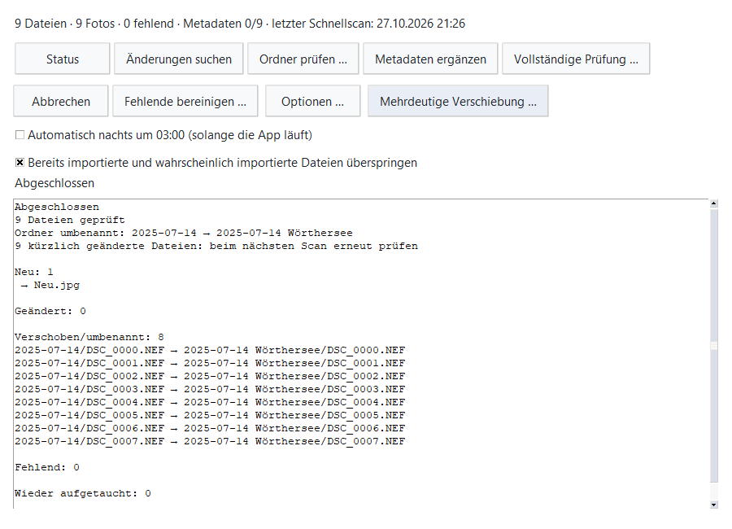

# Sammlungsindex

Start the app with `uv run python main.py` and choose **Sammlung · Index**.
The selected import destination is the collection root. The first scan asks
before creating `.myfotomanager`; photos and Lightroom catalogs are never
modified. `main.py` is unchanged.

## Operations

- **Änderungen suchen** inventories the collection. **Ordner prüfen …** limits
  the scan and missing-file detection to a selected collection subfolder.
- **Metadaten ergänzen** reads EXIF/MakerNotes in batches of up to 200 files.
  Install [ExifTool](https://exiftool.org/) separately and put `exiftool` on PATH,
  or set its executable path through **Optionen …**. `-fast` is intentional:
  [ExifTool documents that `-fast2` skips MakerNotes](https://exiftool.org/exiftool_pod2.html#fast-NUM).
  ExifTool is only invoked with read arguments. No source metadata is written.
- **Vollständige Prüfung …** establishes full BLAKE3 checksums; later runs compare
  them and retain the original checksum on mismatch, so repeated checks continue
  to report possible corruption. Files changed since the inventory are reported
  separately and need another quick scan.
- **Fehlende bereinigen …** requires confirmation and removes missing file/EXIF
  records. Photo anchors, merge redirects, change history, and future user tables
  remain intact. Photo IDs use AUTOINCREMENT and are never reused.
- **Optionen …** edits collection preferences: extensions, exclusion globs (relative
  paths, case insensitive), independent export folders, extension folders used
  for RAW/JPEG pairing, and the ExifTool executable path.
- Nightly metadata runs at local 03:00 when enabled and the application is running.
  This preference and the duplicate-skip preference live in the existing local
  application settings; default configuration in `config/settings.py` is unchanged.

Reports include counts, old/new paths, renamed folders, ambiguous candidates,
unreadable paths, uncertain files modified in the last ten seconds, and checksum
mismatches. Empty/unreachable roots, cancelled scans, and scans with access errors
never mark unseen files missing. Above 20% missing, the UI asks and rescans before
marking them. Missing records are retained until explicitly purged.

## Imports

When the collection has an index, source days show imported counts and fully
imported days are dimmed. Import checks prefer camera identity over filename and
size; known missing photos are eligible for reimport. Pending metadata can yield
`imported_likely`, which is skipped by default alongside `imported`.
Filename/size candidates are additionally checked against a quick content hash;
different content is never skipped on that heuristic alone. Disable
**Bereits importierte … überspringen** in the index window to copy those again.
If ExifTool cannot run, import checking reports an error; configure it or choose a
destination without an index. A completed import automatically scans only its
destination folder, with another scan after optional DNG conversion.

## API and operational notes

`core.collection_index.CollectionIndex.open(Path(root))` is a context manager.
Create/use/close it on the same thread. Public operations include `quick_scan`,
`enrich_metadata`, `verify`, `check_import`, `changes_since`, `photo_files`,
`purge_missing`, `resolve_move`, `status`, and `configure`. File/change records are
dictionaries; import results and scan results are dataclasses. Callers can pass a
`threading.Event` for cancellation and a progress callback receiving a dictionary.
Quick-scan progress has throughput; metadata progress has a total. A quick scan
cannot estimate remaining time before directory enumeration finishes.

The inventory was introduced with schema version 1. The current database migrates
to version 3: version 2 adds face data and version 3 adds model-specific reference
exclusions. It retains UUID collection identity, WAL, and a consistent
`.myfotomanager.bak` SQLite backup after index operations. Extensions use versioned
migrations in the same database; see [ADR-0008](../ADR/0008-lokale-sqlite-sammlung.md).
Photo merges keep the oldest ID,
retain the losing anchor, record `merged` changes, and store
`photo.redirect.<old_id>` in settings. Consumers should follow these redirects.

Only one writer opens a collection at a time. Another instance opens read-only.
The lock records host/PID. After an abnormal process termination, verify that the
recorded process has exited before manually removing `.myfotomanager.lock`.
UNC paths trigger an SMB warning; a local-database relocation option is not
implemented. Mapped network drives are not automatically detected. Use one writer
across machines; SQLite on SMB cannot guarantee reliable locking.

Folder renames with unique, identical name/size lists do not read image contents.
Other moves prefer the volume/file ID, then cached quick hashes. A cross-volume
move whose original was never fingerprinted cannot be matched by content after
the original disappears; run verification before reorganizing across volumes to
prime quick hashes. Unresolved cases remain added/missing. Ambiguous cached-hash
matches can be explicitly paired with **Mehrdeutige Verschiebung …**.

## Validation

Run `uv run python -m pytest`. Collection tests use generated temporary collections
and controlled ExifTool results; actual camera NEF/DNG MakerNotes must additionally
be checked with representative camera files and an installed ExifTool.

Run `uv run python benchmarks/collection_index.py --files 100000` for first/repeat
scan rates including photo pairing, change logging, indexes, and backup time.
Dummy creation and cleanup are outside the scan timings. SSD, USB, and SMB targets
must be measured independently; local results do not establish NAS throughput.

On this Windows workspace, the generated 100,000-file collection completed the
initial inventory in 6.02 s (16,624 files/s), and the unchanged scan in 4.05 s
(24,673 files/s), including backup. The first-scan SSD target of 20,000 files/s
has not been reached here; USB/NAS rates and the 50-files/s metadata target have
not been validated. Windows IDs use batched
[directory information queries](https://learn.microsoft.com/en-us/windows/win32/api/winbase/ns-winbase-file_id_both_dir_info),
with a temporary mapping for one directory, avoiding an extra file-open per
entry. Unsupported filesystems fall back to `DirEntry.inode()`.

