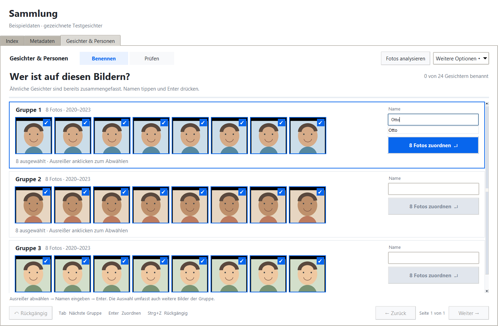

# Gesichtserkennung: Bedienung und Umsetzung

## Einstieg

1. `uv sync` ausführen und [Modelle installieren](../models/README.md).
2. App mit `uv run python main.py` starten, Zielordner auswählen und den
   Sammlungsindex erfassen. Für sichere RAW/JPEG-Paarung und Aufnahmejahre
   **Metadaten ergänzen** ausführen; RAW-Vorschauen benötigen ExifTool.
3. Unter **Sammlung · Metadaten → Gesichter & Personen → Fotos analysieren**
   die Sammlung untersuchen. Ordnerauswahl und Abbruch stehen unter
   **Weitere Optionen**. Erneutes Starten setzt die Analyse fort.
4. **Benennen** zeigt pro Gruppe genau eine Zeile: ähnliche Gesichter,
   Anzahl und Aufnahmejahre links, das Namensfeld direkt rechts. Alle Gesichter
   sind ausgewählt. Ausreißer durch Anklicken abwählen, Namen tippen und **Enter**
   drücken. Bestehende Namen werden vorgeschlagen; Pfeil hoch/runter wählt einen
   Vorschlag. Ein neuer Name legt die Person zusammen mit der Zuordnung an.
   Ein zusätzlicher Dialog oder ein vorheriges Anlegen der Person entfällt.
5. Nach der Zuordnung geht der Fokus zur nächsten Gruppe. **Tab / Umschalt+Tab**
   wechselt zwischen Namen. **Rückgängig / Strg+Z** nimmt bis zu 20 Zuordnungen
   der laufenden Sitzung zurück, einschließlich Ablehnungen und Fixierungen.
   Andere Änderungen, eine neue Analyse oder ein Sammlungswechsel beenden diesen
   Zuordnungsverlauf. Bei gleichnamigen Personen die richtige Person aus der Liste
   wählen; die Identität bleibt intern ihre ID.
6. Große Gruppen bleiben zusammen. **Weitere Bilder** blättert durch ihre
   Gesichter; Auswahl und Namensentwurf bleiben erhalten. Der Zuordnungsbutton
   nennt die Anzahl über die ganze Gruppe, einschließlich weiterer Bilder.
   Abgewählte Gesichter werden für diesen Namen als Ablehnung gespeichert, damit
   die automatische Erkennung sie nicht sofort wieder derselben Person zuordnet.
7. **Prüfen** zeigt Vorschläge ebenfalls als Gruppen mit bereits ausgefülltem
   Namen. Enter bestätigt die Gruppe. Falsche Gesichter abwählen oder den Namen
   direkt korrigieren. Damit funktioniert die Prüfung mit derselben Bedienung.
8. Unter **Weitere Optionen** sind Personenverwaltung, Referenz- und
   Validierungsbilder, Ausreißerprüfung, Modelle, Datensatzexport und Kalibrierung
   erreichbar. **Alle Gesichter**
   zeigt auch niedrige Qualität und ignorierte Gesichter. Eine ausdrückliche
   Zuordnung hebt das Ignorieren auf.



Pro Seite werden höchstens acht Gruppen und pro Gruppe acht Vorschauen geladen.
Auch eine Gruppe mit mehr als 60 Gesichtern wird nicht zwischen Seiten zerteilt.
Die Konstanten `FACE_GROUPS_PER_PAGE`, `FACE_GROUP_PREVIEWS`,
`FACE_GROUP_THUMBNAIL_SIZE` und `FACE_NAMING_UNDO_LIMIT` stehen zentral in
`config/settings.py`. Am Datenbankschema ändert dieser UI-Umbau nichts.

**Person / Beziehungen** zeigt Attribute, Datensatzgrößen, abgedeckte Jahre,
Foto-Dateien und abgeleitete Verwandtschaft. Eltern-/Kindbeziehungen werden
kanonisch gespeichert, Partnerschaft und explizite Geschwister symmetrisch.
Selbstbeziehungen und Abstammungszyklen werden verhindert; mehr als zwei Eltern
erzeugen eine Warnung. Zusammenführen erhält eine Weiterleitung der alten ID.
Widersprüchliche bestätigte Zuordnungen auf demselben Foto sind vorher aufzulösen.

## Verarbeitung und Modellwechsel

Die bestehende `files.photo_id`-Zuordnung bleibt maßgeblich; es gibt keine zweite
Paarungslogik und keine neue `photos`-Tabelle. Pro Foto wird bevorzugt das JPEG,
sonst ein eingebettetes RAW-JPEG ausgewertet. Koordinaten und Landmarks beziehen
sich auf genau diese orientierte Quelle. Keine RAW-Entwicklung, keine Änderungen
an Fotos oder Sidecars. Die Foto-Dateiliste übernimmt die Rolle der in der
Spezifikation vorgeschlagenen `photo_files`-Tabelle.

SQLite-Migrationen erweitern den Index von Version 1 auf 2 (Gesichtsdaten) und 3
(modellbezogene Referenzausschlüsse). WAL, kurze Batchtransaktionen und der
bestehende Sammlungsschreibschutz gelten auch für Gesichtsaktionen. Zwei Threads
dekodieren maximal acht Bilder voraus; Inferenz läuft seriell mit wiederverwendeten
CPU-Sessions. Embeddings werden bildübergreifend in Batches bis 32 berechnet.
Die Import-Vorschau erhält an Checkpoints Vorrang.

Der aktive Detektor und Embedder, Schwellen, Datensatzgröße sowie Import- und
Nachtoptionen werden pro Sammlung gespeichert. **Modelle / Einstellungen** zeigt
Lizenz, Installation und Größe. Geschwindigkeit ist als nicht gemessen markiert,
solange kein eigener Messwert im Manifest vorliegt.

Nach einem Modellwechsel **Fotos analysieren** starten. Der Fortschritt zeigt
fertige und übersprungene Fotos. Ein Embedderwechsel ergänzt fehlende Vektoren;
alte Vektoren bleiben erhalten. Ein Zurückwechseln verwendet den Cache.
Während der Neuindizierung werden neue Zuordnungen erst nach dem Abschluss
bewertet. Nutzerzuordnungen bleiben am Gesicht gespeichert.

Beim Detektorwechsel entsteht eine `.myfotomanager.before-detector-*.bak`.
Überlappende Gesichter derselben Quelle werden ab IoU 0,5 einander zugeordnet;
Nutzerlabels, Ablehnungen und Ignorieren bleiben erhalten. Nicht wiedergefundene
bestätigte Gesichter bleiben als **beibehalten** sichtbar. Zwischen verschiedenen
Quellen, etwa beschnittenem JPEG und RAW, wird eine Zuordnung nicht allein anhand
normalisierter Koordinaten übertragen.

Automatische Importuntersuchung und Nachtlauf sind zunächst aus. Nach Aktivierung
startet die Erkennung nach einem erfolgreichen Index-Schnellscan des Importordners.
Der Nachtlauf startet um 03:00, solange die App läuft. Bei aktivierter nächtlicher
Metadatenpflege folgt er deren Abschluss. Bereits laufende Gesichtsaufträge
werden nicht doppelt gestartet. Erkannte Namen und Vorschläge erscheinen auch
im Detailbereich des Metadatenbrowsers.

## Lernen und Datensatz

Nur bestätigte Gesichter guter Qualität werden Referenzen. Automatische Labels
lernen nicht selbst weiter. Der Matcher mittelt bis zu drei beste Ähnlichkeiten
pro Person, berücksichtigt Ablehnungen und optimiert Zuordnungen gemeinsam pro
Foto. Eine Person wird dabei höchstens einmal vorgeschlagen/automatisch zugeordnet.
Geburtsjahre können unmögliche Zuordnungen ausschließen. Häufiges gemeinsames
Auftreten verändert nur unsichere Vorschläge, höchstens um 0,03; es erzeugt keine
automatische Zuordnung über die Auto-Schwelle hinweg.

Der Datensatz wird pro Embedder deterministisch aus Nutzerlabels aufgebaut:
Qualitätsfilter, Ausreißerprüfung am Kosinus-Medoid und nächsten Nachbarn,
Duplikat-/Serienfilter, Jahreskontingente, qualitätsgewichtete Farthest-Point-
Auswahl und separater Validierungssplit. Fixierungen zählen auf das Limit.
Zu kleine Limits werden abgewiesen. **Aus Datensatz entfernen** schließt ein
Beispiel modellbezogen aus, erhält aber seine bestätigte Identität; erneutes
Fixieren nimmt es wieder auf. Pins haben bei der Auswahl Vorrang vor dem
Duplikatfilter; beim manuellen Fixieren auf unterschiedliche Beispiele achten.

**Datensatz exportieren** schreibt nicht ausgerichtete 256-px-Ausschnitte mit
1,6-fachem Rand, Quellkoordinaten und Metadaten nach `.myfotomanager_faces/`.
Ordnernamen verwenden ausschließlich Personen-IDs. Namen/Attribute werden nicht
exportiert. Der Export wird atomar aus der DB synchronisiert und nicht zurückgelesen.
Der unveränderte DB-Stand ergibt unveränderte Exportdateien. Unter Windows wird
der Ordner versteckt; er kann im eigenen Backup-Programm ausgeschlossen werden.

**Alle Gesichtsdaten löschen** entfernt Personen, Embeddings, Zuordnungen,
Beziehungen, Einstellungen und den Export. Es bereinigt auch die von der App
angelegten Datenbanksicherungen. Fotoindex und Originalfotos bleiben bestehen.
Extern kopierte Backups liegen außerhalb der Verwaltung der App.

## Validierung

```powershell
uv run python -m pytest
uv run python scripts/preview_faces.py --output docs/screenshots/face-group-naming.png
```

Tests verwenden synthetische Bilder und deterministische Modelle; sie benötigen
keine Downloads. Sie prüfen unter anderem Abbruch/Wiederaufnahme, Paarung,
Modellwechsel, Ablehnungen, Konflikte, Alignment, alle acht EXIF-Orientierungen,
RAW-Vorschauen, Referenzauswahl, Export, Löschung, Graph und echte Tk-Interaktionen.
Die Gruppenbedienung wird zusätzlich mit 70 Gesichtern, Ausreißer-Ablehnung,
Autovervollständigung, Enter, Tab, Seitenwechsel, Fokus und Rückgängig geprüft.
Die beiden echten Modellkonsistenztests werden ohne private Referenzbilder
übersprungen. Mit `$env:FACE_REFERENCE_DIR='D:/Testset'` werden auch diese Tests
gegen die installierten Embedder ausgeführt.

Für echte Modellkonsistenz und Precision/Recall eigene Fotos unter numerischen
Personenordnern bereitstellen, z. B. `D:/Testset/000001/*.jpg` und
`D:/Testset/000002/*.jpg`, mindestens zwei Einzelpersonenfotos pro Person.
Ein optionaler Ordner `unknown` enthält Personen, die nicht in den Referenzen sind.
Dateien mit mehreren oder keinen erkannten Gesichtern werden als Fehler gemeldet.

```powershell
uv run python scripts/evaluate_faces.py D:/Testset --output D:/face-evaluation.json
uv run python scripts/evaluate_faces.py D:/Testset --detector scrfd_10g --embedder arcface_buffalo_l
```

Die erste Hälfte der sortierten Bilder jeder Person dient als Referenz, die
zweite als Validierung. Unbekannte werden nur validiert. Der Bericht enthält
Auto-Precision/-Recall, Fehler, Matchingzeiten und Bildlaufzeiten. Ohne akzeptierte
Auto-Zuordnungen ist Precision `null`, nicht 100 %. Die GUI-Kalibrierung zeigt
Kosinus-Verteilungen, einen Schwellenvorschlag und Werte pro Person auf dem
kuratierten Validierungssplit; die Schwelle wird nicht automatisch übernommen.

Lokaler Funktionstest mit den öffentlichen OpenCV-Beispielen `lena.jpg` und
`messi5.jpg`: beide Modellpaare erkennen Gesichter; SFace liefert 128, ArcFace 512
Dimensionen. Helligkeitsvarianten desselben Bildes lagen über 0,998, unterschiedliche
Personen bei ca. 0,13 bzw. 0,03. Gemessene reine Detektion: YuNet 0,01–0,03 s,
SCRFD ca. 0,13 s; Matching bei 100.000 Referenzen mit 128 Dimensionen ca. 24–29 ms.
Diese Messungen sind maschinenabhängige Funktionstests. Das Ziel ≥98 % Auto-
Precision auf der privaten Sammlung ist ohne deren gelabeltes Testset nicht belegt.

## Bewusste Anpassungen an die vorhandene App

- Tkinter ruft `FaceService` direkt aus einem Worker auf; ein HTTP-Server wäre
  für diese lokale Desktop-App zusätzliche Infrastruktur ohne Nutzen.
- YuNet/SFace sind die voreingestellten kleinen Modelle; SCRFD/ArcFace sind als
  vollständige ONNX-Adapter und installierbare Manifeste enthalten. AdaFace wird
  über einen eigenen ONNX-Export eingebunden; kein ungeprüftes Gewicht mit
  erfundener Prüfsumme wird angeboten.
- Unbekannte werden per konservativem Complete-Link-Kosinus gruppiert, ohne
  zusätzliche HDBSCAN-Abhängigkeit. Die Gruppen entstehen bei Abfrage neu und
  werden nicht als dauerhafte Identitäten gespeichert.
- Nach Nutzerkorrekturen wird der kuratierte Satz vollständig deterministisch
  neu ausgewählt, statt eine zweite, abweichende inkrementelle Auswahl zu pflegen.
  Das priorisiert konsistente Ergebnisse; sehr große kuratierte Sammlungen können
  dafür längere Hintergrundläufe benötigen.
- Der Validierungssplit bevorzugt unterschiedliche Tage; bei zu wenigen Tagen
  greift ein deterministischer Fallback. Bei weniger als drei Beispielen bleibt
  alles Referenz. Die Kalibrierung benötigt mindestens zwei Personen.
- Es gibt keinen externen Scheduler: automatische Jobs setzen eine laufende App
  voraus. Ein belegter Sammlungsschreibschutz wird angezeigt, nicht umgangen.
