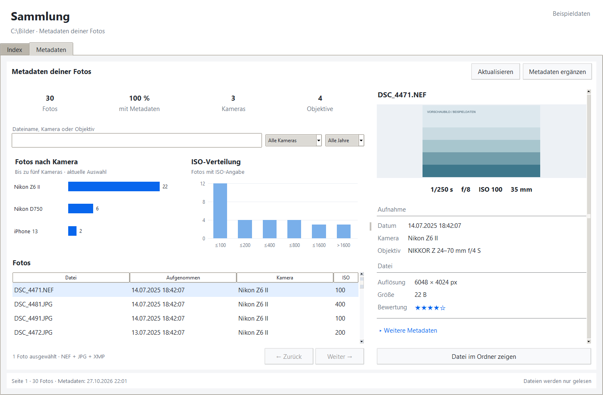

# Metadatenansicht

Über **Sammlung · Metadaten** öffnet sich die Sammlung mit den Reitern **Index**
und **Metadaten**. Die Metadatenansicht entspricht dem freigegebenen Bildentwurf:
Kennzahlen, Kamera-/ISO-Diagramme, Filter und Fotoliste links, Bildvorschau mit
Aufnahmedaten rechts. Die vorhandenen Scan- und Verwaltungsfunktionen bleiben
im Reiter **Index** erreichbar.



## Bedienung

- Der bereits ausgewählte Zielordner ist die Sammlung. Ohne Index zeigt die
  Ansicht einen Hinweis; sie legt beim Lesen keine Datenbank an.
- **Metadaten ergänzen** startet die vorhandene EXIF-/MakerNotes-Anreicherung.
  Anschließend aktualisiert sich die Ansicht. Bereits gespeicherte Metadaten
  lassen sich ohne installierten ExifTool anzeigen.
- Die Suche berücksichtigt Dateinamen, relative Pfade, Kameras und Objektive.
  Kamera und Aufnahmejahr lassen sich zusätzlich filtern. Kennzahlen und
  Diagramme beziehen sich auf die aktuelle Filterauswahl.
- Ein RAW/JPG-Paar zählt als ein Foto. XMP-Dateien werden als zugehörige Varianten
  angezeigt und nicht als weitere Aufnahmen gezählt. Fehlende Dateien erscheinen
  nicht in der Liste. Noch nicht gelesene Metadaten bleiben als unbekannt sichtbar.
- **Fotos nach Kamera** zeigt bis zu fünf Kameras, **ISO-Verteilung** zählt die
  Bereiche bis einschließlich 100, 200, 400, 800, 1600 und über 1600. Fotos ohne
  positive ISO-Angabe werden nicht in das ISO-Diagramm aufgenommen.
- Ein Klick auf eine Spaltenüberschrift sortiert die Liste; ein weiterer Klick
  kehrt die Reihenfolge um. **Zurück/Weiter** blättert durch jeweils 200 Fotos.
- Beim Auswählen eines Fotos erscheinen Belichtungszeit, Blende, ISO, Brennweite,
  Aufnahmezeit, Kamera, Objektiv, Auflösung, Dateigröße und Bewertung. Unter
  **Weitere Metadaten** stehen Seriennummer, Auslösungen, Subsekunden, Zeitzone,
  GPS-Koordinaten, Farbmarkierung, Lesestatus und relativer Pfad. XMP-Bewertungen
  und -Farbmarkierungen haben Vorrang vor eingebetteten Werten. Alles ist lesend;
  die Sterne ändern keine Bewertung.
- Vorschauen verwenden eine vorhandene Bilddatei, bevorzugt ein zugehöriges JPG.
  Bei reinen NEF/NRW/DNG-Aufnahmen wird alternativ mit ExifTool eine eingebettete
  Vorschau gelesen. Ist keine Vorschau verfügbar, erscheint ein Hinweis. Es wird
  keine RAW-Konvertierung ausgeführt. **Datei im Ordner zeigen** markiert die
  ausgewählte Quelldatei im Windows-Explorer.

## Technik und Prüfung

Die Datenabfragen und Vorschaudecodierung laufen in getrennten Hintergrund-Workern.
Eine neue Anfrage ersetzt noch nicht gestartete Arbeit; veraltete Ergebnisse
werden anhand einer Versionsnummer verworfen. Es werden nur 200 Tabellenzeilen
an Tk übergeben. Zusammenfassungen zählen auf Foto-Ebene, während die Abfragen
innerhalb eines konsistenten SQLite-Snapshots und mit temporären Tabellen im
Speicher laufen. Vollständige ExifTool-JSON-Daten werden nicht für die Übersicht
kopiert. Es werden keine neuen Datenbanktabellen oder Metadatenfelder benötigt.

Neue Standardwerte in `config/settings.py`: 200 Fotos pro Seite, 250 ms
Suchverzögerung, Vorschau maximal 480 × 285 Pixel, 10 s Zeitlimit pro
ExifTool-Vorschauabfrage. `main.py` bleibt unverändert.

`uv run python -m pytest` prüft unter anderem RAW/JPG/XMP-Paarbildung in den
Diagrammen, teilweise vorhandene Metadaten, Unicode-Suche, Filterkombinationen,
Seitengrenzen, Sortierung, XMP-Bewertungen, JPEG-/RAW-Vorschauen und das Verwerfen
veralteter Ergebnisse beim Filtern und Schließen. Echte RAW-Vorschauen hängen
von Kameraformat und installierter ExifTool-Version ab; die RAW-Tests verwenden
kontrollierte Prozessantworten.

Screenshot reproduzieren:

```powershell
uv run python scripts/preview_metadata.py --output docs/screenshots/metadata-dashboard.png
```

Optional liefert `--photo C:\Pfad\Foto.jpg` ein echtes Vorschaubild. Das Skript
erzeugt ausschließlich eine temporäre Beispielsammlung mit isolierten
App-Einstellungen; das angegebene Foto wird nur gelesen.
